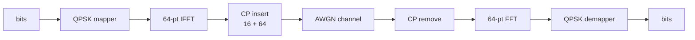
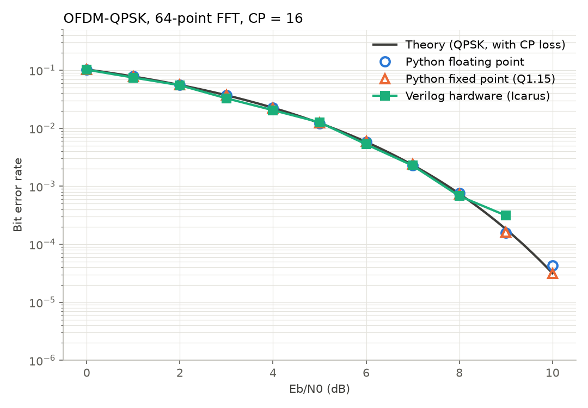
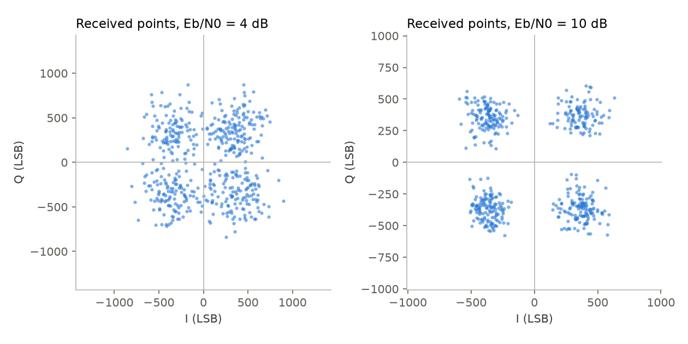
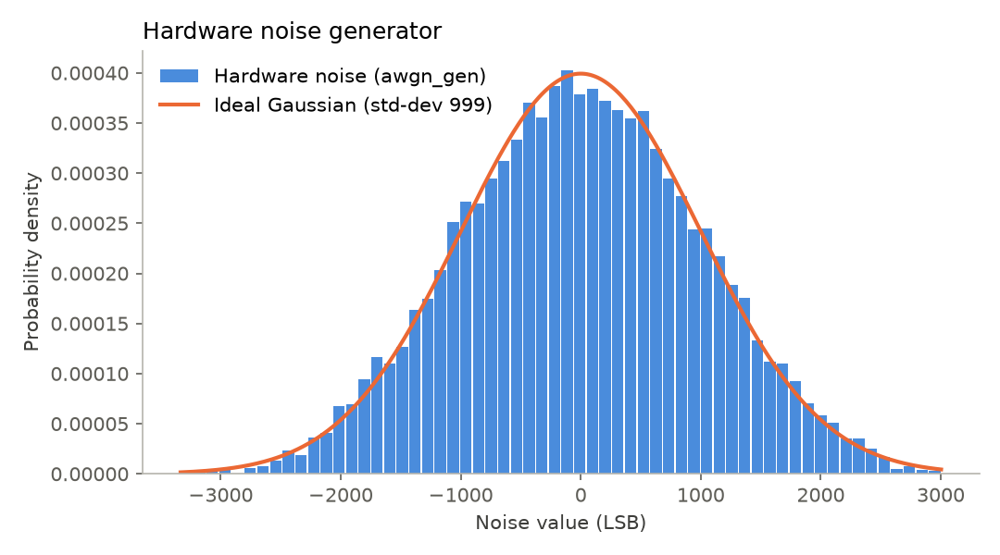

# OFDM Baseband Modem (Verilog)

A complete OFDM-QPSK baseband modem: Python golden model → bit-exact Q1.15 fixed-point
model → synthesizable Verilog → self-checking testbenches → hardware BER vs theory.



## Run it

```sh
./run.sh          # all tests + quick BER sweep (~1 min), opens sim/output.html
./run.sh full     # longer BER sweep for a smoother curve (~10 min)
```

In VS Code: **Cmd+Shift+B** runs the same thing.
Needs: Icarus Verilog, Yosys, netlistsvg (`npm install -g netlistsvg`), Python venv in `python_model/.venv`.

`sim/output.html` shows the test results, the BER graph, circuit schematics and waveforms.

## Specs

| Item | Value |
|---|---|
| Modulation | QPSK, Gray coded |
| FFT size | 64 (radix-2 DIT, in-place, one butterfly per clock) |
| Cyclic prefix | 16 samples (80 samples per OFDM symbol) |
| Number format | Q1.15, 16-bit I and Q |
| FFT scaling | ÷2 per stage (÷64 total) — cannot overflow |
| FFT latency | 64 load + 192 compute + 64 output clocks |
| Channel | AWGN, sum of 4 uniform numbers (8 xorshift32 generators), programmable level |
| Synthesis (Yosys, generic gates) | ~51k cells, ~6.5k flip-flops |

## Files

| Path | What it is |
|---|---|
| `python_model/ofdm_model.py` | Floating-point golden model with preamble sync |
| `python_model/ofdm_fixed.py` | Bit-exact fixed-point model; writes `tb/vectors/*.hex` |
| `rtl/qpsk_mapper.v`, `rtl/qpsk_demapper.v` | QPSK mapping / hard decision |
| `rtl/butterfly_r2.v`, `rtl/twiddle_rom.v` | Radix-2 butterfly, twiddle ROM (generated by `scripts/gen_twiddle.py`) |
| `rtl/fft64.v` | 64-point FFT/IFFT |
| `rtl/cp_insert.v`, `rtl/cp_remove.v` | Cyclic prefix |
| `rtl/awgn_gen.v` | Hardware noise channel |
| `rtl/ofdm_tx.v`, `rtl/ofdm_rx.v`, `rtl/ofdm_top.v` | Transmitter, receiver, top level |
| `tb/` | Self-checking testbenches (print PASS/FAIL) |
| `scripts/plot_ber.py` | BER, constellation and noise plots |
| `tools/make_output.py` | Builds `sim/output.html` |

## Results

Every block matches the Python fixed-point model **exactly** (0 mismatches, 0 LSB error).
Noise-free loopback gives 0 bit errors. The hardware BER follows theory from 0 to 10 dB:



| Received constellation | Hardware noise generator |
|---|---|
|  |  |

Details: `docs/ber_summary.md`.

## Chip layout (SkyWater sky130, OpenLane 2)

Full RTL-to-GDSII flow with OpenLane 2.3.10 (`openlane/config.json`, 40 ns clock).

| Item | Result |
|---|---|
| Die size | 1.17 mm × 1.18 mm (1.38 mm²) |
| DRC / LVS | Clean (0 errors) |
| Timing at 25 MHz | Met at typical (+16.6 ns) and fast corners; slow corner (100 °C, 1.6 V) about 7 ns short |
| Power (typical) | 0.18 W |
| Antenna | 5 remaining violations (from 327) after diode insertion |

Run it: `openlane --design-dir . openlane/config.json` (Docker image `ghcr.io/efabless/openlane2:2.3.10`).
Quick logic-only synthesis to sky130 cells: `yosys scripts/synth_sky130.ys`
(needs `sky130_fd_sc_hd__tt_025C_1v80.lib` in `build/pdk/`).

## Next steps

- Pipeline the longest FFT path so timing also closes at the slow corner.
- Preamble generator and frame sync in hardware — the Python model has it; the hardware receiver currently relies on the valid signal.
- 16-QAM, pilots and channel equalisation.
